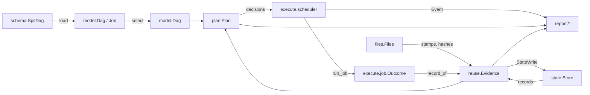

# Runner architecture overhaul

Design for review; no implementation started. Written against `origin/dev` at e6acb64.

## What is wrong

The runner is a pipeline of data (DAG → decisions → outcomes → records and output), but the code is laid out around the commands instead:

- **Reuse has no owner.** "Is this job's recorded work still valid?" is answered in `plan.judge`, re-derived in `explain`, approximated in `migrate._plan_job` (through the private `plan._unchanged`) and in `plan.reconcile`. A `RunRecord` is built or patched in seven places across `plan`, `run` and `migrate`. Identity (`_slots`, `_fingerprint`, `checks_key`) lives in the loader; the record key (`job_key`) lives in the planner.
- **`plan.py` is three modules**: the state file (`RunRecord`, `State`, locking, compaction, the version written twice), reuse evidence (`stamp`, `_unchanged`, `reconcile`, `adopt`) and the graph walk (`plan`, `Status`, `Decision`).
- **`Job` drops what it reads.** Inputs are bare path strings; product, entities and kind survive only inside `identities` and `folders`. Every new DAG field crosses `schema`, `Job`, `load_dag`, and each hand-built `Job(...)` in tests.
- **`run.execute` is one closure** that waits on dependencies, re-plans `maybe` jobs, takes slots, starts processes, stages outputs, hashes, writes state and prints.
- **Causes are prose.** `Decision.reason` and `Result.error` are strings; `DEPENDENCY_BLOCKED` is a prefix that `_located` parses back; tests and `explain` work from the wording. `cli.main` builds the JSON, the summary counts and the stale count itself.
- **Stamps are bare lists** read by index in `plan`, `run` and `explain`.
- **`--move-files` plans up to three times**, because relocation is a pre-pass outside the planner rather than a decision the planner makes.

## Target

Each box is a module with one subject. Stages are functions over plain frozen dataclasses; the only stateful objects are `state.Store` (a file) and `files.Files` (a read cache for one pass).

### Modules

- **`schema.py`** — unchanged: the strict wire model, one `VERSION`.
- **`model.py`** (from `dag.py`'s types) — `Dag`, `Job`, and typed artifacts:
  - `Artifact(slot: Slot, path: str, kind: Kind, product: str, entities: Entities)`; `Kind` is an enum (`FILE`, `FOLDER`).
  - `Job.inputs: tuple[Port, ...]` (each a name and its artifacts in order), `Job.outputs: tuple[Port, ...]`; `paths`, `input_paths`, `output_paths` are derived.
  - `Check.side: Side` enum (`BEFORE`, `AFTER`), not a string.
  - `Dag.layout: Layout` — every `.spit-bash/` path (state, logs) and the temp-file names (`.x.spit-bash-partial`, `.x.spit-bash-previous`) in one place.
  - `tests/support.py` gains the one `job(...)` builder; no test constructs `Job` directly.
- **`load.py`** (rest of `dag.py`) — validation and argument-part resolution, as now. It no longer computes fingerprints.
- **`files.py`** (from `plan.stamp*`, `run._folder_entries`, `content.py`) — what is on disk:
  - `Stamp(size, mtime_ns, count: int | None)` NamedTuple, with `describe()` for messages.
  - `Files(dag, cached: bool)`: `stamp(path)`, `hash(path)`, `entries(path)`; a planning pass caches every read, a run reads fresh. `Files.with_overrides(...)` replaces the `seen` argument that `plan --move-files` passes today.
- **`state/`** — persistence only:
  - `record.py`: `Record` (today's `RunRecord`) and `Key`.
  - `store.py`: `Store` — read, lock, append, forget, compact; `VERSION` once. It knows nothing about jobs.
  - `StateWrite` (record or forget) is the only way anything else changes the store, so planning returns writes rather than performing them.
- **`reuse/`** — the single owner of "is recorded work valid here":
  - `identity.py`: `slots`, `work` (fingerprint and its parts), `checks_key`, `key` (today's `job_key`). Computed once per job at load, stored on `Job.work: Work`.
  - `evidence.py`: `evidence(job, record, files, compare: Compare) -> Evidence`. `Evidence` holds the record (or none), which work parts changed, whether checks changed, and a `FileDiff(slot, path, recorded, now, content: Content)` for every file that differs, where `Content` is `SAME | DIFFERS | NO_HASH | NOT_COMPARED | UNREADABLE`. `Compare` is the `--compare` enum (`STAT`, `CONTENT`, `FULL`), replacing the `hashing`/`verify` pair.
  - `verdict.py`: `verdict(evidence) -> Verdict` — `CURRENT`, `CHECKS_ONLY`, or `STALE(cause)`, plus the refreshed record when files were only touched. This is today's `judge` minus the graph.
  - `records.py`: every record built in one place — `after_run(job, outcome)`, `refreshed`, `checked`, `adopted`, `relocated`.
  - `relabel.py` (today's `reconcile`) and `relocate.py` (today's `migrate.find`): both consume `Evidence`, so neither re-implements comparison, and both return `StateWrite`s and file moves.
- **`plan.py`** — the graph walk only: externals, programs, upstream statuses, `maybe`. It calls `reuse.verdict` for each command job.
  - `Decision(job, status, cause: Cause, waits_for, caused_by, writes: tuple[StateWrite, ...])`.
  - `Cause` is an enum with a detail payload: `OUTPUT_MISSING(stranded_at)`, `INPUT_CHANGED`, `WORK_CHANGED(parts)`, `NO_RECORD`, `FORCED`, `CHECKS_CHANGED`, `MISSING_EXTERNAL(paths)`, `PROGRAM_NOT_FOUND(names)`, `DEPENDENCY_BLOCKED(first)`, `UPSTREAM_MAY_RUN`, and so on. `caused_by` reads the payload, not a string prefix.
  - Relocation becomes a planner decision: with `--move-files`, a job whose verdict is `STALE(OUTPUT_MISSING)` and whose evidence finds the recorded outputs elsewhere is planned `Status.PLACE` with its moves. `run` performs the moves as that job's action, ordered before its consumers by the existing dependency wait. One plan call, for both `plan` and `run`. This is also where the copy-and-place steps of `product-identity-47-plan.md` belong.
- **`execute/`** — split by what can change independently:
  - `process.py`: `run_command(spec: CommandSpec, log) -> CommandEnd` — subprocess, memory polling, SIGTERM/SIGKILL. `CommandEnd` is an enum-tagged result (`EXITED(code)`, `KILLED_MEMORY(used)`, `KILLED`, `NOT_STARTED(error)`), and the error text is made in `report`.
  - `job.py`: `run_job(job, files, log, runner=run_command) -> Outcome` — before-checks, verify, set aside, make folders, commands, stdout rename, input-change detection, missing outputs, after-checks, restore or remove. `Outcome` is `MADE(stamps, seconds)` or `FAILED(Failure)`, with `Failure` as typed as `Cause`. Also `check_job` and `place_job`.
  - `scheduler.py`: `execute(dag, decisions, store, options, on_event) -> tuple[Result, ...]` — dependency waiting, settling `maybe` (through `reuse.verdict`), `ReadyQueue` slots, cancellation. It writes `reuse.records.*` results to the store and emits `Event`s (`STARTED`, `DONE`, `CHECKED`, `SKIPPED_UNCHANGED`, `FAILED`, `NOT_RUN`); it never prints.
  - A second backend (Slurm, containers) replaces `runner`, or `run_job` wholesale; the scheduler and records stay.
- **`report/`** — everything that reaches the terminal or stdout:
  - `plan_text.py` (today's `report.py` counts and causes), `plan_json.py`, `explain.py` (renders `Evidence`, computes nothing), `run_text.py` (consumes `Event`s, the run summary and failure groups), `causes.py` (the one place `Cause` and `Failure` become words).
  - `summary.py`: `Summary.of(decisions, results)` — the counts, cutoffs and stale jobs as data, used by the text and by any later `run --json`.
- **`cli.py`** — parse arguments into an `Options` dataclass, call the stages in order, pick the renderer, map to an exit code. Target under 200 lines.
- **Kept as they are**: `schedule.py`, `progress.py`, `selection.py`, `display.py`, `memory.py`, `logs.py`.

### What an extension then touches

- A new DAG field: `schema`, `model`, `load`, and `reuse.identity` if it is part of the work.
- A new reuse rule: `reuse/` and its tests.
- A new status or cause: the enum, `plan`, `report/causes.py`.
- A new output format: `report/`.
- A new backend: `execute/process.py` or `execute/job.py`.

## Steps

Each step is one pull request that keeps behaviour and output byte-for-byte the same, except step 7. The test suite must stay green throughout. Tests that reach into internals (`run_module._input_changes`, `mock.patch(planning.stamp)`, direct `Job(...)`) move to public boundaries in the step that moves what they reach into.

1. **Pin the output.** Extend `tests/test_output.py` with stored outputs of `plan`, `plan --verbose`, `plan --json`, `plan --job`, `run` and `run --verbose` over the examples, including a blocked job, a failure, a `maybe` cutoff and a `--move-files` relocation. Every later step diffs against these.
2. **`files.py` and `Stamp`.** Move stamps, folder entries and content hashing; replace every index read.
3. **`state/` out of `plan.py`.** `Store` and `Record`; `StateWrite`; one `VERSION`.
4. **Typed `Job`.** `Artifact`, `Port`, `Kind`, `Side`, `Layout`; the one test builder.
5. **`reuse/`.** Identity moves from the loader; `Evidence` and `verdict` replace `judge`'s comparisons and `_unchanged`; `explain`, `relabel` and `relocate` consume `Evidence`; all record construction moves to `reuse/records.py`. Planning returns `StateWrite`s instead of `apply_refreshes` mutating the store.
6. **`Cause`, `Failure` and `report/`.** Replace prose reasons with enums; move all printing, JSON and summary counting out of `cli`, `run` and `plan`.
7. **Split `execute`.** `process`, `job`, `scheduler`, events. Messages stay the same, so step 1's outputs still hold.
8. **Relocation as a decision.** `Status.PLACE`, one plan call, `migrate.py` deleted. This changes `plan --verbose` output (the moves appear as decisions), so its stored outputs are re-saved and the README's `--move-files` section updated.

Steps 2–4 are independent of each other; 5 needs 2–4; 6 and 7 need 5; 8 needs 5 and 6.

### Progress

Branch `overhaul/stack`, not pushed:

- [x] 1. Pin the output — bedc497. Stored outputs in `tests/fixtures/output/`; re-save with `SPIT_BASH_BLESS=1`. `plan --job` under `--move-files` shows a moved input as missing; step 8 changes that.
- [x] 2. `files.py` and `Stamp` — b2a22a6. `content.py` folded in; the state format is unchanged, converted by `files.stored`.
- [x] 3. `state/` — 740d3b0. `State` is `Store`, `RunRecord` is `Record`, `VERSION` once, `StateWrite` and `Store.apply`.
- [x] 4. Typed `Job` — b5b8569. `dag.py` is `model.py` and `load.py`; `Artifact`, `Port`, `Kind`, `Side`, `Layout`; the test builder is `support.job`, and the old JSON-entry helper is `support.job_entry`. The `--state`/`--logs` help text still spells the default paths out.
- [x] 5. `reuse/` — 281cb81. `identity`, `evidence`, `verdict`, `records`, `relabel`, `relocate`; `Job.work`; `Compare`; `Decision.writes`; `Store.assume`; `migrate.py` deleted. Hash calls per test and state bytes match step 4.
- [x] 6. `Cause` and plan-side `report/` — 1683d9e. `cause.py` (`Why` with paths, jobs, parts), `AdoptCause`, `MoveCause`; `report/` holds causes, plan text and JSON, explain, failures.
- [x] 7. Split `execute` — fb644d7, merged in a5047f2. `execute/` (process, job, failure, events, options, scheduler); `report/run_text.py` and `report/summary.py`; `run.py` deleted. SIGTERM still stops jobs and restores set-aside outputs.
- [x] 8. Relocation as a decision — c739deb. `Status.PLACE` with `Decision.placement`; one `plan()` call; `execute/job.place_job` with `PlaceFailed`; `relocate.find`/`apply` deleted. Only `tests/fixtures/output/moved.txt` changed. A job below a `run` or `maybe` job is never placed.

## Out of scope

- The DAG format and SPIT. Nothing here needs a compiler change. `docs/spitdag.md`'s example still saying `"version": 10` is a SPIT documentation fix, separate from this.
- New features: a remote backend, `run --json`, new statuses beyond `PLACE`.
- The schema's exact-version gate, which stays.

## Completion

Before merge, delete this plan in a standalone final commit that records its path, what was built, any step left undone with its issue, and how to read it again from the commit's parent.
